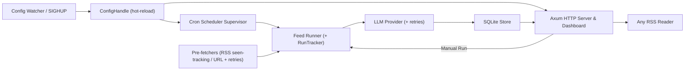

# llm-to-rss

Turn scheduled LLM prompts—with optional live web-search grounding and URL/RSS pre-fetchers—into virtual **Atom 1.0** and **RSS 2.0** feeds consumable by any RSS reader (FreshRSS, Miniflux, Tiny Tiny RSS, NetNewsWire, Newsboat, etc.).

Instead of pushing noisy alerts into chat apps, `llm-to-rss` lets you define declarative YAML "virtual feeds" (morning briefings, flight/hardware price watchers, release digests) and read them on your own terms inside your RSS reader with unread state, categories, and archive search.

## Features

- **Declarative Virtual Feeds (`feeds/*.yaml`) with Hot-Reload**: Add, edit, or disable feed YAML files in `feeds/` and changes are automatically picked up by the HTTP server and cron scheduler without restarting (also supports `SIGHUP` and `POST /reload`). Invalid edits are rejected safely while keeping the last known-good config active.
- **Live Data Grounding**:
  - Native provider web search: OpenAI Responses API (`web_search`), Google Gemini (`google_search`), and Anthropic Messages API (`web_search`).
  - Pre-fetchers (`sources:`): pull live RSS/Atom feeds or web pages/JSON endpoints and inject them into the prompt before calling the LLM.
  - Works with local/self-hosted OpenAI-compatible endpoints too (Ollama, vLLM, OpenRouter, LiteLLM, Perplexity).
- **Stateful & Incremental Runs**:
  - `{{previous_entry}}` & `{{previous_entry_date}}`: inject the last stored entry into the prompt so price watchers and monitors can compute deltas.
  - Seen-item tracking (`only_new: true` by default on `type: rss` sources): records processed RSS/Atom GUIDs/links in SQLite so only new articles since the last successful run are sent to the LLM.
- **Resilience & Noise Controls**:
  - Automatic exponential-backoff retries on HTTP `429`, `408`, `5xx`, and transient transport errors (respecting `Retry-After`) across both source fetchers and LLM providers.
  - `fail_on_source_error: false`: tolerate individual flaky sources instead of aborting the whole briefing.
  - `skip_if_contains`, `skip_if_no_new_items`, `deduplicate`, and `max_items` retention pruning.
- **Standard Feed Server & Dashboard**:
  - Serves Atom 1.0 (`/feeds/<id>.xml`), RSS 2.0 (`/feeds/<id>.rss`), OPML 2.0 (`/opml.xml`), health JSON (`/healthz`), manual trigger endpoints (`POST /feeds/<id>/run`, `POST /reload`), and an interactive status dashboard (`/`) with one-click **Run now** and **Reload config** controls.
  - Includes a `docker-compose.yml` (with an optional `--profile freshrss` service if you want a local reader bundled).

## Architecture



## Quickstart (Docker Compose)

1. Copy the example config and environment file:

   ```bash
   cp .env.example .env
   cp config.example.yaml config.yaml
   ```

2. Add your API key(s) in `.env` (for example `OPENAI_API_KEY` or `GEMINI_API_KEY`).

3. Start `llm-to-rss` (or include `--profile freshrss` if you also want a local FreshRSS container):

   ```bash
   docker compose up -d --build
   # Optional: include a local FreshRSS instance on http://localhost:8081
   # docker compose --profile freshrss up -d --build
   ```

   If you push this repository as a **public** GitHub repo, [`.github/workflows/docker.yml`](.github/workflows/docker.yml) automatically builds and publishes free multi-arch (`linux/amd64`, `linux/arm64`) images to `ghcr.io/<your-user>/llm-to-rss:latest`, which you can reference with `image: ghcr.io/<your-user>/llm-to-rss:latest` in your homelab `docker-compose.yml` instead of building locally.

4. Trigger an initial run (optional — you can also click **Run now** on `http://localhost:8080/`):

   ```bash
   docker compose exec llm-to-rss llm-to-rss run --config /config/config.yaml
   ```

5. Subscribe in your RSS reader to individual feeds (e.g. `http://localhost:8080/feeds/morning-briefing.xml` or `.rss`) or import all feeds at once via `/opml.xml` (if running inside the same Docker network, use `http://llm-to-rss:8080/...`).

## Quickstart (Local Rust Binary)

```bash
cp .env.example .env
cp config.example.yaml config.yaml

# Validate configuration and feed YAML files
cargo run -- validate --config config.yaml

# Dry-run a single feed without writing to SQLite or marking RSS items seen
cargo run -- run --config config.yaml --feed morning-briefing --dry-run

# Run all enabled feeds once
cargo run -- run --config config.yaml

# Start HTTP server + cron scheduler + config hot-reloader
cargo run -- serve --config config.yaml
```

## Declarative YAML Reference

Both `config.yaml` and `feeds/*.yaml` support environment variable expansion before YAML parsing:
- `${VAR}` — replaced with the value of `VAR` (or empty string if unset/empty).
- `${VAR:-default}` — replaced with `VAR` if set and non-empty, otherwise `default`.

### Main Configuration (`config.yaml`)

| Field | Type | Default | Description |
|---|---|---|---|
| `server.bind` | string | `"0.0.0.0:8080"` | Listen address (`host:port`). Requires restart if changed. |
| `server.base_url` | string | `$LLM_TO_RSS_BASE_URL` or `"http://localhost:8080"` | Base URL used in Atom/RSS self links, entry links, and OPML `xmlUrl`. |
| `server.trigger_token` | string (optional) | unset | Optional Bearer token protecting `POST /feeds/{id}/run` and `POST /reload`. If unset, manual triggers work without authentication (convenient for trusted LANs); if set, the dashboard shows a session token input. |
| `server.reload_interval_secs` | integer | `2` | Polling interval (seconds) for hot-reloading `config.yaml` and `feeds_dir`. Set to `0` to disable polling (`SIGHUP` and `POST /reload` still work). |
| `storage.db_path` | path | `"data/llm-to-rss.db"` | SQLite database path (relative paths resolve against `config.yaml`'s directory). Requires restart if changed. |
| `defaults.timezone` | string | `$TZ` or `"UTC"` | Default IANA timezone (e.g. `"Europe/Berlin"`, `"Europe/Warsaw"`) for cron schedules and `{{date}}`. |
| `defaults.max_items` | integer | `50` | Default maximum stored entries per feed before oldest entries are pruned. |
| `defaults.timeout_secs` | integer | `90` | Default per-request LLM HTTP timeout in seconds (source fetches are capped at 60s). |
| `defaults.max_retries` | integer | `3` | Retry attempts on HTTP `429`, `408`, `5xx`, and transient network errors. |
| `defaults.retry_base_delay_ms` | integer | `1000` | Initial exponential backoff delay in milliseconds (capped at 30s; respects `Retry-After`). |
| `defaults.fail_on_source_error` | bool | `true` | Default behavior when a pre-fetcher source fails. Set `false` to warn and continue with remaining sources. |
| `feeds_dir` | path (optional) | unset | Directory scanned for `*.yaml` / `*.yml` feed files (relative to `config.yaml`). |
| `providers.<name>` | map | `{}` | Named LLM provider definitions referenced by feeds. |
| `feeds` | list | `[]` | Optional inline feed definitions (merged with `feeds_dir`). |

#### Provider Configuration (`providers.<name>`)

| Field | Type | Default | Description |
|---|---|---|---|
| `kind` | enum (required) | — | One of `openai_responses`, `gemini`, `anthropic`, `openai_compatible`. |
| `model` | string (required) | — | Default model ID for this provider (can be overridden per feed). |
| `api_key` | string (optional) | unset | API key (required for OpenAI/Gemini/Anthropic; optional for local `openai_compatible` like Ollama). |
| `base_url` | string (optional) | provider default | Custom API base URL (e.g. `"http://localhost:11434/v1"` for Ollama). |
| `web_search` | bool | `false` | Default native web search toggle for feeds using this provider. |
| `temperature` | float (optional) | unset | Sampling temperature passed to the provider. |
| `max_tokens` | integer (optional) | unset | Maximum output tokens (Anthropic defaults to `4096` if unset). |
| `extra_headers` | map<string, string> | `{}` | Extra HTTP headers sent on every provider request. |

### Virtual Feed Files (`feeds/*.yaml`)

Drop one `*.yaml` or `*.yml` file per virtual feed into `feeds/`:

```yaml
title: "Rust Ecosystem Pulse"
description: "Daily highlights from Rust blogs and releases."
category: "Tech"
enabled: true
schedule: "0 8 * * *" # 08:00 daily in defaults.timezone (or per-feed timezone)
provider: "openai_search"
web_search: true
fail_on_source_error: false
skip_if_no_new_items: true
deduplicate: true
max_items: 30

sources:
  - type: rss
    name: "This Week in Rust"
    url: "https://this-week-in-rust.org/rss.xml"
    limit: 10
    only_new: true

prompt: |
  Today is {{date}}. Summarize the top 5 Rust ecosystem updates and notable crate releases.
  Start with a `# Headline` and include links.

  Previous digest ({{previous_entry_date}}):
  {{previous_entry}}

  New articles:
  {{sources}}
```

#### Feed Fields

| Field | Type | Default | Description |
|---|---|---|---|
| `id` | string | filename stem | Unique feed slug matching `^[a-z0-9][a-z0-9_-]*$`. Determines `/feeds/<id>.xml` and `/feeds/<id>.rss`. |
| `title` | string (required) | — | Feed display title in Atom/RSS, OPML, and the dashboard. |
| `description` | string (optional) | unset | Feed subtitle / description. |
| `category` | string (optional) | `"Virtual Feeds"` | OPML category folder and dashboard grouping. |
| `enabled` | bool | `true` | When `false`, the feed is skipped by the scheduler and omitted from OPML (still viewable on the dashboard and manually runnable). |
| `schedule` | string (required) | — | Cron expression: standard 5-field (`min hour dom month dow`) or 6/7-field (`sec min hour dom month dow [year]`). |
| `timezone` | string (optional) | `defaults.timezone` | Per-feed IANA timezone override. |
| `provider` | string (required) | — | Key referencing an entry in `providers:`. |
| `model` | string (optional) | provider's `model` | Per-feed model override. |
| `web_search` | bool (optional) | provider's `web_search` | Per-feed native web search override. |
| `system_prompt` | string (optional) | built-in RSS prompt | Custom system instruction sent to the LLM. |
| `prompt` | string (required) | — | User prompt template (supports template variables below). |
| `entry_title_template` | string (optional) | leading `# Headline` or `<title> — <date>` | Custom template for generated entry titles. |
| `sources` | list | `[]` | Pre-fetcher sources (`type: rss` or `type: url`) injected before calling the LLM. |
| `fail_on_source_error` | bool (optional) | `defaults.fail_on_source_error` | If `false`, failed sources are logged and replaced with `[Source unavailable: ...]` instead of aborting the run. |
| `skip_if_contains` | string (optional) | unset | Suppress publishing an entry when the LLM output contains this substring (e.g. `"NO_UPDATE"`). |
| `skip_if_no_new_items` | bool | `false` | When `true` and all `only_new: true` RSS sources return zero unseen items, skip the run before calling the LLM. |
| `deduplicate` | bool | `false` | Skip publishing if the SHA-256 hash of the LLM output matches the previous stored entry. |
| `max_items` | integer (optional) | `defaults.max_items` | Maximum retained entries in SQLite for this feed. |
| `run_on_startup` | bool | `false` | Run once immediately when `llm-to-rss serve` starts. |

#### Source Types (`sources:`)

- **`type: rss`** (supports both RSS 2.0 and Atom 1.0):
  - `name` (required): Heading shown in `{{sources}}`.
  - `url` (required): Feed URL.
  - `limit` (optional, default `15`): Maximum items included per run (applied after filtering seen items).
  - `only_new` (optional, default `true`): Filter out items already processed in previous successful non-dry-run executions (tracked by GUID/ID/link in SQLite).
- **`type: url`** (HTML pages, plain text, or JSON endpoints):
  - `name` (required): Heading shown in `{{sources}}`.
  - `url` (required): Target URL.
  - `max_chars` (optional, default `12000`): Maximum characters retained after HTML-to-text cleanup.
  - `headers` (optional): Map of extra HTTP request headers.

### Template Variables

Available inside `prompt`:
- `{{date}}` — current date in the feed's timezone (`YYYY-MM-DD`)
- `{{datetime}}` — current RFC 3339 timestamp in the feed's timezone
- `{{feed_title}}` / `{{feed_id}}` — metadata from the feed YAML
- `{{sources}}` — formatted output of pre-fetched `sources` (if omitted when `sources` are configured, appended automatically)
- `{{previous_entry}}` — last stored entry's timestamp, title, and Markdown body (useful for delta tracking in price watches and monitors)
- `{{previous_entry_date}}` — local date (`YYYY-MM-DD`) of the last stored entry, or `none` on the first run

Available inside `entry_title_template`:
- `{{date}}`, `{{datetime}}`, `{{feed_title}}`, `{{headline}}` (first `# ...` line extracted from the LLM output)

## Provider Kinds

| `kind` | API Endpoint | Web Search Support | Typical Use |
|---|---|---|---|
| `openai_responses` | `/v1/responses` | Native `web_search` tool + `url_citation` links | OpenAI models (`gpt-4o`, etc.) |
| `gemini` | `/v1beta/models/{model}:generateContent` | Native `google_search` grounding + source links | Gemini models (`gemini-2.5-flash`, etc.) |
| `anthropic` | `/v1/messages` | Native `web_search_20250305` tool | Claude models |
| `openai_compatible` | `/v1/chat/completions` | Provider-specific (e.g. Perplexity `sonar`, OpenRouter `:online`) | Ollama, OpenRouter, Perplexity, LiteLLM |

## HTTP Endpoints

| Method & Path | Description |
|---|---|
| `GET /` | Interactive HTML status dashboard with **Run now** and **Reload config** buttons |
| `GET /feeds/<id>.xml` (or `.atom`) | Atom 1.0 feed for `<id>` |
| `GET /feeds/<id>.rss` | RSS 2.0 feed for `<id>` |
| `GET /opml.xml` | Category-grouped OPML 2.0 subscription list for all enabled feeds |
| `GET /healthz` | Health & feed count JSON |
| `POST /feeds/<id>/run` | Trigger an immediate feed run (returns `409 Conflict` if already running; requires `Authorization: Bearer <trigger_token>` when configured) |
| `POST /reload` | Reload `config.yaml` and `feeds/` from disk immediately (same auth as `/feeds/<id>/run`; also triggered automatically on file changes or `SIGHUP`) |

## CLI Reference

```text
llm-to-rss validate [--config config.yaml]
llm-to-rss list [--config config.yaml]
llm-to-rss run [--config config.yaml] [--feed <id>] [--dry-run]
llm-to-rss opml [--config config.yaml] [--base-url http://localhost:8080]
llm-to-rss serve [--config config.yaml]
```

## License

MIT — see [LICENSE](LICENSE).
