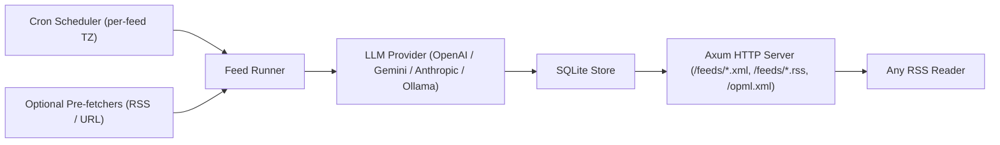

# llm-to-rss

Turn scheduled LLM prompts—with optional live web-search grounding and URL/RSS pre-fetchers—into virtual **Atom 1.0** and **RSS 2.0** feeds consumable by any RSS reader (FreshRSS, Miniflux, Tiny Tiny RSS, NetNewsWire, Newsboat, etc.).

Instead of pushing noisy alerts into chat apps, `llm-to-rss` lets you define declarative YAML "virtual feeds" (morning briefings, flight/hardware price watchers, release digests) and read them on your own terms inside your RSS reader with unread state, categories, and archive search.

## Features

- **Declarative Virtual Feeds (`feeds/*.yaml`)**: Add a new feed by dropping a single YAML file into `feeds/`.
- **Live Data Grounding**:
  - Native provider web search: OpenAI Responses API (`web_search`), Google Gemini (`google_search`), and Anthropic Messages API (`web_search`).
  - Pre-fetchers (`sources:`): pull live RSS/Atom feeds or web pages/JSON endpoints and inject them into the prompt before calling the LLM.
  - Works with local/self-hosted OpenAI-compatible endpoints too (Ollama, vLLM, OpenRouter, LiteLLM, Perplexity).
- **Noise Controls**:
  - `skip_if_contains`: suppress publishing an entry when nothing interesting happened (e.g., `"NO_UPDATE"` for price alerts).
  - `deduplicate`: skip publishing identical consecutive responses.
  - `max_items`: automatic SQLite retention pruning per feed.
- **Standard Feed Server**:
  - Serves Atom 1.0 (`/feeds/<id>.xml`), RSS 2.0 (`/feeds/<id>.rss`), OPML 2.0 (`/opml.xml`), health JSON (`/healthz`), and a status dashboard (`/`).
  - Includes a `docker-compose.yml` (with an optional `--profile freshrss` service if you want a local reader bundled).

## Architecture



## Quickstart (Docker Compose)

1. Copy the example config and environment file:

   ```bash
   cp .env.example .env
   cp config.example.yaml config.yaml
   ```

2. Add your API key(s) in `.env` (for example `OPENAI_API_KEY` or `GEMINI_API_KEY`).

3. Start `llm-to-rss` (or include `--profile freshrss` if you also want a local FreshRSS container):

   ```bash
   docker compose up -d --build
   # Optional: include a local FreshRSS instance on http://localhost:8081
   # docker compose --profile freshrss up -d --build
   ```

   If you push this repository as a **public** GitHub repo, [`.github/workflows/docker.yml`](.github/workflows/docker.yml) automatically builds and publishes free multi-arch (`linux/amd64`, `linux/arm64`) images to `ghcr.io/<your-user>/llm-to-rss:latest`, which you can reference with `image: ghcr.io/<your-user>/llm-to-rss:latest` in your homelab `docker-compose.yml` instead of building locally.

4. Trigger an initial run (optional, so feeds already have items before their next cron tick):

   ```bash
   docker compose exec llm-to-rss llm-to-rss run --config /config/config.yaml
   ```

5. Subscribe in your RSS reader to individual feeds (e.g. `http://localhost:8080/feeds/morning-briefing.xml` or `.rss`) or import all feeds at once via `/opml.xml` (if running inside the same Docker network, use `http://llm-to-rss:8080/...`).

## Quickstart (Local Rust Binary)

```bash
cp .env.example .env
cp config.example.yaml config.yaml

# Validate configuration and feed YAML files
cargo run -- validate --config config.yaml

# Dry-run a single feed without writing to SQLite
cargo run -- run --config config.yaml --feed morning-briefing --dry-run

# Run all enabled feeds once
cargo run -- run --config config.yaml

# Start HTTP server + cron scheduler
cargo run -- serve --config config.yaml
```

## Adding a Virtual Feed

Create a new file in `feeds/`, e.g. `feeds/rust-weekly.yaml` (the filename stem becomes the feed ID if `id` is omitted):

```yaml
title: "Rust Ecosystem Pulse"
description: "Daily highlights from Rust blogs and releases."
category: "Tech"
enabled: true
schedule: "0 8 * * *" # 08:00 daily in defaults.timezone (or per-feed timezone)
provider: "openai_search"
web_search: true
deduplicate: true
max_items: 30

sources:
  - type: rss
    name: "This Week in Rust"
    url: "https://this-week-in-rust.org/rss.xml"
    limit: 10

prompt: |
  Today is {{date}}. Summarize the top 5 Rust ecosystem updates and notable crate releases.
  Start with a `# Headline` and include links.

  {{sources}}
```

### Template Variables

Available inside `prompt`:
- `{{date}}` — current date in the feed's timezone (`YYYY-MM-DD`)
- `{{datetime}}` — current RFC 3339 timestamp in the feed's timezone
- `{{feed_title}}` / `{{feed_id}}` — metadata from the feed YAML
- `{{sources}}` — formatted output of pre-fetched `sources` (if omitted when `sources` are configured, appended automatically)

Available inside `entry_title_template`:
- `{{date}}`, `{{datetime}}`, `{{feed_title}}`, `{{headline}}` (first `# ...` line extracted from the LLM output)

## Provider Kinds

| `kind` | API Endpoint | Web Search Support | Typical Use |
|---|---|---|---|
| `openai_responses` | `/v1/responses` | Native `web_search` tool + `url_citation` links | OpenAI models (`gpt-4o`, etc.) |
| `gemini` | `/v1beta/models/{model}:generateContent` | Native `google_search` grounding + source links | Gemini models (`gemini-2.5-flash`, etc.) |
| `anthropic` | `/v1/messages` | Native `web_search_20250305` tool | Claude models |
| `openai_compatible` | `/v1/chat/completions` | Provider-specific (e.g. Perplexity `sonar`, OpenRouter `:online`) | Ollama, OpenRouter, Perplexity, LiteLLM |

## CLI Reference

```text
llm-to-rss validate [--config config.yaml]
llm-to-rss list [--config config.yaml]
llm-to-rss run [--config config.yaml] [--feed <id>] [--dry-run]
llm-to-rss opml [--config config.yaml] [--base-url http://localhost:8080]
llm-to-rss serve [--config config.yaml]
```

## License

MIT — see [LICENSE](LICENSE).
